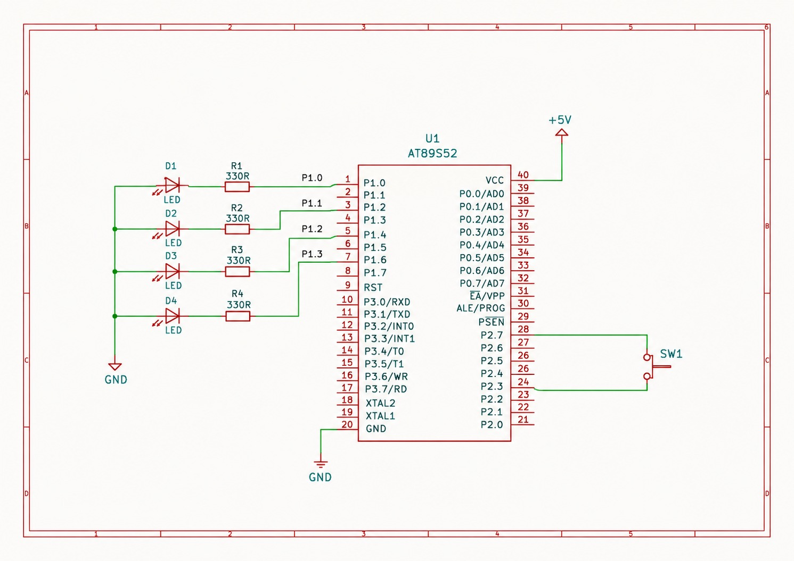

# EXPERIMENT DETAILS

**EXP:** CONTINUOUS LAB EVALUATION – 3

**DATE:** 27/07/2026

**NAME OF EXP:** Timer-Based LED Pattern Generator and Button Interrupt Controller

**HARDWARE SETUP / PLATFORM:** Keil µVision + AT89S52 8051 Microcontroller Development Board

**TASK NO:** Four-State LED Pattern Generator using Bare-Metal Embedded C

---

## 1. Circuit Diagram

The experiment uses four LEDs connected to Port 1 and a push-button connected to Port 2 of the AT89S52 microcontroller.

**Hardware Connections:**

- **Development Board:** AT89S52 8051 Development Board
- **Microcontroller IC:** AT89S52
- **LED 1:** P1.0
- **LED 2:** P1.1
- **LED 3:** P1.2
- **LED 4:** P1.3
- **Push-button input:** P2.3
- **Switch row control:** P2.7
- **Power Supply:** +5V DC
- **Ground:** Common GND

**Circuit Diagram:**

---

## 2. Core Logic / Pseudocode / Code Base

### Working Principle

The experiment implements a four-state LED control system using direct memory-mapped register access in Embedded C. Four LEDs are connected to Port 1, and a push-button connected to Port 2 is used to switch between the operating modes.

Each valid button press advances the system to the next LED pattern. After the fourth mode, the system returns to the first mode.

### Operating Modes

**Mode 1 – Running LED Pattern**

- LEDs turn ON one after another.
- The sequence follows LED1 → LED2 → LED3 → LED4.
- The pattern repeats continuously.

**Mode 2 – Binary Counter**

- The four LEDs display a 4-bit binary count.
- The count progresses from 0000 to 1111 and repeats.

**Mode 3 – Alternating Pattern**

- LEDs display alternating patterns:
  - 1010
  - 0101
- The patterns repeat continuously.

**Mode 4 – All LED Flash**

- All four LEDs turn ON together.
- All four LEDs then turn OFF together.
- The sequence repeats continuously.

### Pseudocode

1. Start the program.
2. Configure P1.0–P1.3 as LED output pins.
3. Configure P2.7 as the switch-row output and P2.3 as the switch input.
4. Initialize the operating mode to 0.
5. Continuously execute the LED pattern corresponding to the current mode.
6. Monitor the push-button during pattern execution.
7. When a button press is detected, perform debounce checking.
8. Wait for the button to be released.
9. Increment the operating mode.
10. If the mode exceeds 3, reset it to 0.
11. Repeat the process continuously.

### Code Base

The implementation uses:

- `sbit` declarations to access individual LED and switch pins.
- Port 1 register operations to control the four LEDs.
- A custom `delay_and_check()` function to generate delays while checking for button presses.
- A `switch-case` statement to select the four LED operating modes.
- Button debounce checking to reduce unwanted multiple state transitions.

The program is written in bare-metal Embedded C using the `reg51.h` header file without using Arduino APIs, HAL libraries or RTOS services.

---

## 3. INFERENCE

The experiment demonstrates direct GPIO control using the AT89S52 microcontroller. Four different LED patterns are implemented using register-level programming, and a push-button is used to switch between the operating modes.

The custom delay function allows the controller to monitor button activity while executing LED patterns. Thus, the experiment demonstrates bare-metal GPIO programming, LED pattern generation, button handling and basic switch debouncing.
