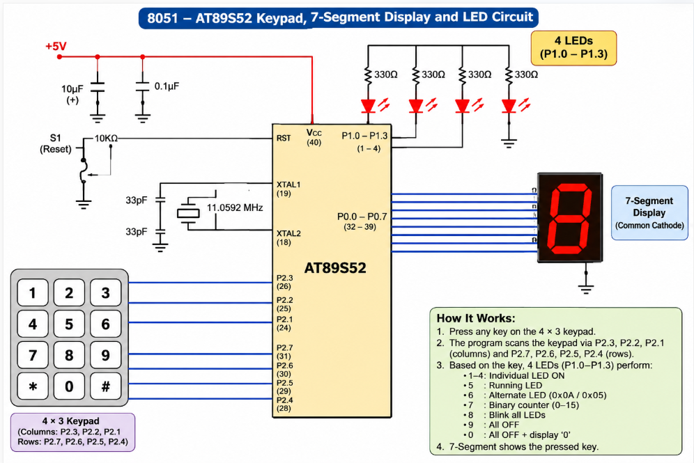

# EXPERIMENT DETAILS

**EXP:** CONTINUOUS LAB EVALUATION – 4

**DATE:** 03/08/2026

**NAME OF EXP:** Human-Machine Interface using Matrix Keypad, LEDs, and Seven-Segment Display

**HARDWARE SETUP / PLATFORM:** Keil µVision + AT89S52 (8051) Development Board

---

## TASK – Matrix Keypad, LEDs, and Seven-Segment Display

### 1. Circuit Diagram

The experiment uses a 4×3 matrix keypad as the input device, four LEDs to indicate different operating modes, and a seven-segment display to show the pressed key.

- **Development Board:** AT89S52 (8051) Development Board
- **Microcontroller IC:** AT89S52
- **Keypad:** 4×3 Matrix Keypad
- **Keypad Row Pins:** P2.7, P2.6, P2.5, P2.4
- **Keypad Column Pins:** P2.3, P2.2, P2.1
- **LED Connections:** P1.0 – P1.3
- **Seven-Segment Display:** Connected to Port P0
- **Display Type:** Common-cathode seven-segment display

**Circuit Diagram:** 

### 2. Core Logic / Pseudocode / Code Base

**Working Principle:**

The experiment demonstrates a simple human-machine interface using an 8051 microcontroller. The matrix keypad is scanned to identify the pressed key. The corresponding digit is displayed on the seven-segment display, while the LEDs perform the operation assigned to that key.

The program uses separate functions for keypad scanning, digit display, and LED control operations.

**Pseudocode:**

1. Initialize the LED port and seven-segment display port.
2. Scan the rows and columns of the matrix keypad.
3. Identify the pressed key.
4. Display the corresponding digit on the seven-segment display.
5. Execute the LED operation based on the pressed key:
   - **Key 1:** LED1 ON.
   - **Key 2:** LED2 ON.
   - **Key 3:** LED3 ON.
   - **Key 4:** LED4 ON.
   - **Key 5:** Running LED pattern.
   - **Key 6:** Alternating LED pattern (1010 ↔ 0101).
   - **Key 7:** Binary counter (0–15).
   - **Key 8:** All LEDs blink.
   - **Key 9:** All LEDs OFF.
   - **Key 0:** Reset system.
6. Repeat the keypad scanning process continuously.

**Code Base:**

The program is written in Embedded C using the `reg51.h` header file.

- `keypad_scan()` – Scans the matrix keypad and identifies the pressed key.
- `display_digit()` – Displays the corresponding number on the seven-segment display.
- `running_led()` – Produces a running LED pattern.
- `binary_counter()` – Displays a 4-bit binary counting sequence.
- `alternate_led()` – Produces an alternating LED pattern.
- `blink_all()` – Makes all four LEDs blink.

The `seg_cod[]` array stores the seven-segment display codes for digits 0–9. Software delay loops are used to provide timing for display and LED operations.

### 3. INFERENCE

The experiment demonstrates interfacing a matrix keypad, LEDs, and a seven-segment display with the AT89S52 microcontroller. The keypad successfully acts as an input device, while the seven-segment display provides visual feedback and the LEDs perform different operations based on the pressed key. This demonstrates GPIO interfacing, keypad scanning, and embedded C programming using the 8051 microcontroller.
