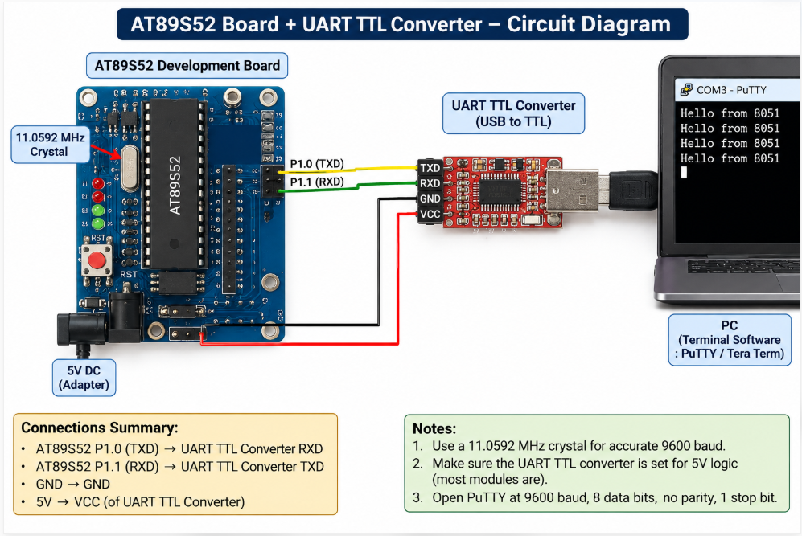

# EXPERIMENT DETAILS

**EXP:** CONTINUOUS LAB EVALUATION – 6

**DATE:** 17/08/2026

**NAME OF EXP:** UART Driver and Serial Debugging – UART Initialization and Character Transmission

**HARDWARE SETUP / PLATFORM:** Keil µVision + AT89S52 (8051) Development Board + USB-to-TTL Converter + PC (PuTTY Terminal)

---

## TASK 6A – UART Initialization and Character Transmission

### 1. Circuit Diagram

The experiment uses the UART communication interface of the AT89S52 microcontroller to transmit serial data to a PC terminal through a USB-to-TTL converter.

- **Development Board:** AT89S52 (8051) Development Board
- **Microcontroller IC:** AT89S52
- **UART Transmit Pin (TXD):** P3.1
- **UART Receive Pin (RXD):** P3.0 (available for bidirectional communication)
- **Communication Interface:** USB-to-TTL Converter
- **Baud Rate:** 9600 bps
- **Data Format:** 8-bit data, no parity, 1 stop bit (8-N-1)
- **Terminal Software:** PuTTY

**Connections:**

| AT89S52 Board | USB-to-TTL Converter |
|---|---|
| TXD (P3.1) | RXD |
| GND | GND |
| RXD (P3.0) | TXD (for future receiving tasks) |

The USB-to-TTL converter must use compatible 5 V TTL logic levels. Do not connect its 5 V supply pin to the board unless the board's power requirements and supply arrangement have been verified.

**Circuit Diagram:** Save the hardware connection diagram in this experiment folder as `circuit.png`.

### 2. Core Logic / Pseudocode / Code Base

**Working Principle:**

The experiment demonstrates UART serial communication using the AT89S52 microcontroller. The UART is configured in Mode 1 for 8-bit asynchronous communication at 9600 baud.

Timer 1 is configured in Mode 2 (8-bit auto-reload) to generate the baud rate. The microcontroller transmits the message `"Hello from 8051"` continuously to the PC through the TXD pin. PuTTY displays the received characters.

**Pseudocode:**

1. Initialize the UART serial communication.
2. Configure the serial port in Mode 1 (8-bit UART).
3. Enable serial reception using REN.
4. Configure Timer 1 in Mode 2 for baud-rate generation.
5. Load TH1 and TL1 with `0xFD` to obtain 9600 baud using an 11.0592 MHz crystal.
6. Start Timer 1.
7. Load each character of the message into the SBUF register.
8. Wait until the TI flag indicates that transmission is complete.
9. Clear the TI flag.
10. Continue transmitting the message followed by a new line.
11. Repeat continuously.

**Code Base:**

The program is written in Embedded C using the `reg52.h` header file.

- `uart_init()` – Configures the UART in Mode 1 and Timer 1 in Mode 2 for 9600 baud communication.
- `uart_tx()` – Transmits one character through the SBUF register and waits for the TI flag to indicate completion.
- `uart_puts()` – Transmits a complete string by sending one character at a time.
- `main()` – Initializes UART and continuously transmits `"Hello from 8051\r\n"`.

The SBUF register is used for serial data transmission, while the TI flag indicates when the transmission of a character is complete.

### 3. INFERENCE

The experiment demonstrates successful UART initialization and serial character transmission using the AT89S52 microcontroller. Timer 1 generates the required baud rate, and the UART transmits data through the TXD pin. The message `"Hello from 8051"` can be observed continuously on the PC terminal using PuTTY, demonstrating serial communication between the microcontroller and the computer.
