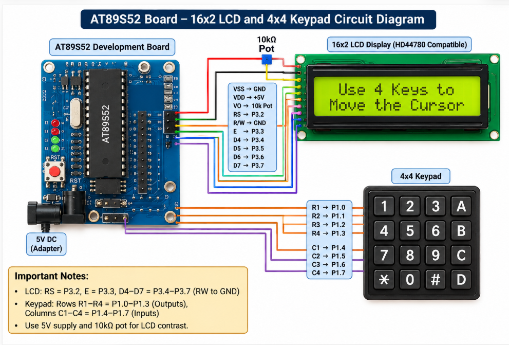

# EXPERIMENT DETAILS

**EXP:** CONTINUOUS LAB EVALUATION 7

**DATE:** 24/08/2026 (Week 6)

**NAME OF EXP:** 4×4 Keypad-Based Character Movement on 16×2 LCD

**HARDWARE SETUP / PLATFORM:** Keil MDK + 8051 Development Board (AT89S52) + 4×4 Matrix Keypad + 16×2 Character LCD (HD44780 Compatible) + Hardware Debugger

---

## TASK 7C – 4×4 Keypad-Based Character Movement

### 1. Circuit Diagram

The experiment demonstrates interfacing a 4×4 matrix keypad with the AT89S52 microcontroller and controlling character movement on a 16×2 character LCD. The keypad is used to provide directional inputs, allowing a character to move UP, DOWN, LEFT, and RIGHT across the LCD display.

- **Development Board:** 8051 Development Board
- **Microcontroller IC:** AT89S52
- **Input Device:** 4×4 Matrix Keypad
- **Output Device:** 16×2 Character LCD (HD44780 Compatible)
- **Keypad Interface:** GPIO-based row-column scanning
- **Keypad Port:** Port 1 (P1.0–P1.7)
- **LCD Data Port:** Port 3 (P3.4–P3.7)
- **Register Select Pin (RS):** P3.2
- **Enable Pin (E):** P3.3
- **Communication:** GPIO-based digital input/output

**Connections:**

**Keypad Connections:**

| Keypad Pin    | AT89S52 Pin | Description    |
| ------------- | ----------- | -------------- |
| Row 1 (R1)    | P1.0        | Row 1 output   |
| Row 2 (R2)    | P1.1        | Row 2 output   |
| Row 3 (R3)    | P1.2        | Row 3 output   |
| Row 4 (R4)    | P1.3        | Row 4 output   |
| Column 1 (C1) | P1.4        | Column 1 input |
| Column 2 (C2) | P1.5        | Column 2 input |
| Column 3 (C3) | P1.6        | Column 3 input |
| Column 4 (C4) | P1.7        | Column 4 input |

**LCD Connections:**

| LCD Pin | AT89S52 Pin   | Description            |
| ------- | ------------- | ---------------------- |
| D4      | P3.4          | Data bit 4             |
| D5      | P3.5          | Data bit 5             |
| D6      | P3.6          | Data bit 6             |
| D7      | P3.7          | Data bit 7             |
| RS      | P3.2          | Command/Data selection |
| E       | P3.3          | Enable signal          |
| RW      | GND           | Write operation        |
| VSS     | GND           | Ground connection      |
| VDD     | +5V           | Power supply           |
| V0      | Potentiometer | Contrast adjustment    |

**Working Configuration:**

- The 4×4 keypad is interfaced through Port 1.
- P1.0–P1.3 are used as keypad row outputs.
- P1.4–P1.7 are used as keypad column inputs.
- The keypad is scanned by driving one row LOW at a time.
- Internal port pull-ups maintain the column inputs HIGH when no key is pressed.
- A 20 ms software delay is used for keypad debouncing.
- The LCD is configured in 4-bit, 2-line mode.
- The character 'O' is initially displayed at the first position of the LCD.
- The character position is updated according to the pressed directional key.

**Keypad Directional Controls:**

| Key | Action | Function   |
| --- | ------ | ---------- |
| 2   | ↑      | Move Up    |
| 8   | ↓      | Move Down  |
| 4   | ←      | Move Left  |
| 6   | →      | Move Right |

### 2. Core Logic / Pseudocode / Code Base

**Working Principle:**

The experiment demonstrates interactive character movement on a 16×2 LCD using a 4×4 matrix keypad interfaced with the AT89S52 microcontroller.

The LCD is connected to Port 3 using a 4-bit communication interface. The RS and Enable signals are connected to P3.2 and P3.3, respectively, while the data pins D4–D7 are connected to P3.4–P3.7.

The 4×4 matrix keypad is connected to Port 1. The four row pins are configured as outputs, and the four column pins are used as inputs.

Initially, the LCD is initialized using the `lcd_init()` function. The keypad port is initialized to `0xFF`, allowing the column inputs to remain HIGH through the port's internal pull-up arrangement.

The function `keypad_scan()` scans the keypad by driving one row LOW at a time while keeping the other rows HIGH. It then reads the column values to identify whether a key has been pressed.

When a key press is detected, a 20 ms delay is introduced to eliminate switch bouncing. The column inputs are checked again to confirm the key press.

The detected key is identified using a predefined 4×4 keymap containing the characters 0–9, A–D, \* and #.

The character 'O' is initially displayed at LCD position (0,0). The current character position is maintained using two variables:

- `row` – Stores the current LCD row position (0 or 1).
- `col` – Stores the current LCD column position (0 to 15).

Based on the detected key:

- Pressing **2** moves the character one position upward.
- Pressing **8** moves the character one position downward.
- Pressing **4** moves the character one position to the left.
- Pressing **6** moves the character one position to the right.

Before moving the character, the previous LCD position is cleared by displaying a blank space. The updated row and column positions are calculated, and the character 'O' is displayed at the new position.

The function `wait_key_release()` ensures that the microcontroller waits until the pressed key is released before accepting another input. This prevents multiple movements from a single key press.

The process continues indefinitely, allowing interactive character movement throughout the 16×2 LCD display.

**Pseudocode:**

1. Include the 8051 microcontroller header file `reg51.h`.
2. Define Port 3 as the LCD data port.
3. Define Port 1 as the keypad interface port.
4. Assign P3.2 as the LCD RS control pin.
5. Assign P3.3 as the LCD Enable control pin.
6. Define the 4×4 keypad keymap.
7. Implement the `delay_ms()` function for software delays.
8. Implement LCD driver functions:
   - `lcd_enable()` – Generates the LCD Enable pulse.
   - `lcd_send_nibble()` – Sends 4-bit data.
   - `lcd_cmd()` – Sends LCD commands.
   - `lcd_data()` – Sends character data.
   - `lcd_init()` – Initializes the LCD in 4-bit mode.
   - `lcd_goto()` – Positions the LCD cursor at the specified row and column.
9. Implement the `keypad_scan()` function:
   - Drive one keypad row LOW at a time.
   - Read the four column inputs.
   - If a key is detected, introduce a 20 ms debounce delay.
   - Read the column inputs again.
   - Identify the pressed key using the keymap.
10. Implement the `wait_key_release()` function to wait until the key is released.
11. Initialize the keypad port to `0xFF`.
12. Initialize the LCD using `lcd_init()`.
13. Set the initial character position to row = 0 and column = 0.
14. Display the character 'O' at the initial position.
15. Enter the infinite loop.
16. Scan the keypad using `keypad_scan()`.
17. If a valid key is detected:
    - Clear the previous character position.
    - If key = '2', decrement the row position.
    - If key = '8', increment the row position.
    - If key = '4', decrement the column position.
    - If key = '6', increment the column position.
18. Ensure the character remains within the LCD boundaries.
19. Display 'O' at the updated LCD position.
20. Wait until the pressed key is released.
21. Repeat the process continuously.

**Code Base:**

The keypad and LCD interfacing are implemented using the following Embedded C functions:

**LCD Driver Functions:**

- `delay_ms()` – Generates software delays for LCD operations and initialization.
- `lcd_enable()` – Generates the Enable pulse to latch data into the LCD.
- `lcd_send_nibble()` – Sends 4-bit data through Port 3.
- `lcd_cmd()` – Transmits LCD commands by sending higher and lower nibbles.
- `lcd_data()` – Transmits individual character data to the LCD.
- `lcd_init()` – Initializes the LCD in 4-bit, 2-line mode.
- `lcd_goto()` – Positions the LCD cursor at the specified row and column.

**Keypad Driver Functions:**

- `keypad_scan()` – Scans the 4×4 matrix keypad and identifies the pressed key using row-column scanning.
- `wait_key_release()` – Waits until the currently pressed key is released to ensure one movement per key press.

**Main Function:**

- `main()` – Initializes the keypad and LCD, displays the initial character, continuously detects keypad inputs, and updates the character position according to the directional commands.

**GPIO Pin Configuration:**

| Port Pin  | Configuration | Function                |
| --------- | ------------- | ----------------------- |
| P1.0–P1.3 | Output        | Keypad row selection    |
| P1.4–P1.7 | Input         | Keypad column detection |
| P3.2      | Output        | LCD RS control          |
| P3.3      | Output        | LCD Enable control      |
| P3.4–P3.7 | Output        | LCD 4-bit data transfer |

**Keypad Key Mapping:**

| Keypad Row | Column 1 | Column 2 | Column 3 | Column 4 |
| ---------- | -------- | -------- | -------- | -------- |
| Row 1      | 1        | 2        | 3        | A        |
| Row 2      | 4        | 5        | 6        | B        |
| Row 3      | 7        | 8        | 9        | C        |
| Row 4      | \*       | 0        | #        | D        |

**Directional Movement Configuration:**

| Key Pressed | Operation  | Condition  |
| ----------- | ---------- | ---------- |
| 2           | Move Up    | `row > 0`  |
| 8           | Move Down  | `row < 1`  |
| 4           | Move Left  | `col > 0`  |
| 6           | Move Right | `col < 15` |

**LCD Position Configuration:**

| Parameter | Minimum Value | Maximum Value |
| --------- | ------------- | ------------- |
| Row       | 0             | 1             |
| Column    | 0             | 15            |

The `lcd_goto()` function uses the following LCD address commands:

| LCD Position | Command         | Function                  |
| ------------ | --------------- | ------------------------- |
| First Row    | `0x80 + column` | Positions cursor on row 1 |
| Second Row   | `0xC0 + column` | Positions cursor on row 2 |

**Debouncing Configuration:**

| Parameter              | Configuration        | Purpose                    |
| ---------------------- | -------------------- | -------------------------- |
| Initial debounce delay | 20 ms                | Eliminates switch bouncing |
| Key confirmation       | Second column read   | Confirms valid key press   |
| Key release detection  | `wait_key_release()` | Prevents repeated movement |
| Release delay          | 20 ms                | Stabilizes key release     |

**Expected Output:**

Initially, the LCD displays the character 'O' at the first position (row 0, column 0).

When the directional keys are pressed, the character moves according to the following operations:

| Key Pressed | Expected Character Movement |
| ----------- | --------------------------- |
| 2           | Moves one position UP       |
| 8           | Moves one position DOWN     |
| 4           | Moves one position LEFT     |
| 6           | Moves one position RIGHT    |

**Example:**

- Initial position: Row 1, Column 1.
- Press key 6: Character moves one position right.
- Press key 6 again: Character moves another position right.
- Press key 8: Character moves to the second row.
- Press key 4: Character moves one position left.

The character 'O' moves dynamically across the 16×2 LCD display according to the keypad inputs.

The character remains within the LCD boundaries and does not move beyond the first or last row and column.

### 3. Inference

The AT89S52 microcontroller successfully interfaces with the 4×4 matrix keypad and 16×2 character LCD using GPIO-based communication.

The keypad is scanned using a row-column scanning technique, where one row is driven LOW at a time and the column inputs are monitored to identify the pressed key.

A 20 ms software debounce delay is implemented to minimize the effect of mechanical switch bouncing. The `wait_key_release()` function ensures that only one movement operation is performed for each valid key press.

The LCD driver successfully initializes the display in 4-bit mode and positions the character 'O' according to the directional commands received from the keypad.

The keys 2, 8, 4, and 6 are used to move the character UP, DOWN, LEFT, and RIGHT, respectively. Boundary checking prevents the character from moving outside the 16×2 LCD display area.

Thus, 4×4 matrix keypad interfacing, row-column scanning, software debouncing, LCD cursor positioning, and interactive character movement using Embedded C on the AT89S52 microcontroller are demonstrated successfully.
