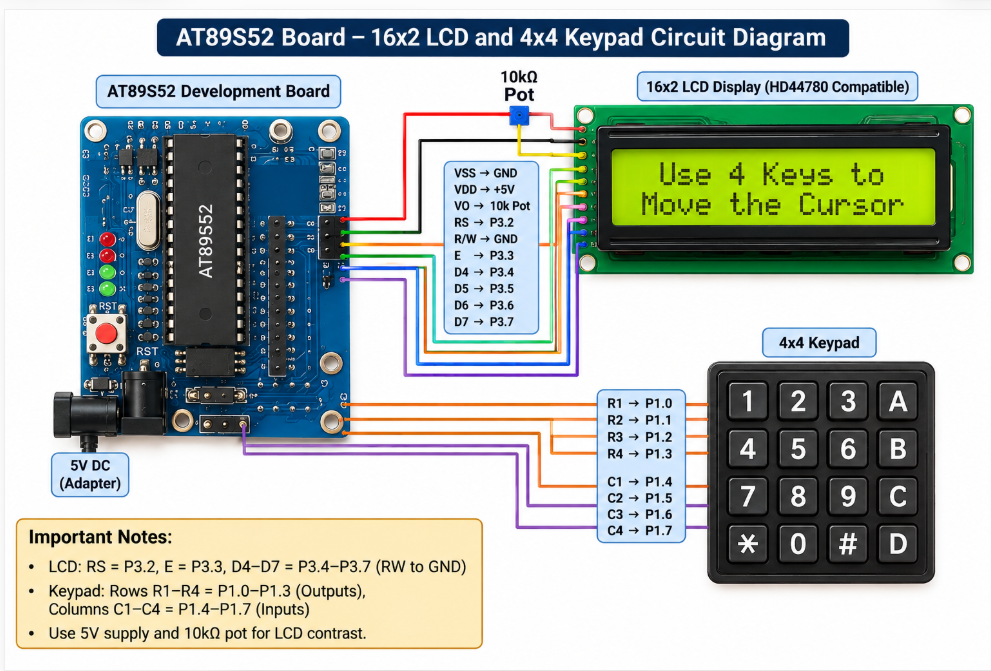

# EXPERIMENT DETAILS

**EXP:** CONTINUOUS LAB EVALUATION – 7

**DATE:** 24/08/2026

**NAME OF EXP:** 16×2 LCD Driver Development and Dynamic Display Control

**HARDWARE SETUP / PLATFORM:** Keil µVision + AT89S52 (8051) Development Board + HD44780-Compatible 16×2 LCD

---

## TASK 7B – Cursor Positioning and Dynamic Value Update

### 1. Circuit Diagram

The experiment uses a 16×2 HD44780-compatible LCD connected to the AT89S52 microcontroller in 4-bit communication mode. The microcontroller controls the LCD to display text at specified cursor positions and dynamically update a counter value.

- **Development Board:** AT89S52 (8051) Development Board
- **Microcontroller IC:** AT89S52
- **LCD Module:** 16×2 HD44780-Compatible LCD
- **Communication Mode:** 4-bit mode
- **LCD Data Pins:** D4–D7 connected to P3.4–P3.7
- **Register Select (RS):** P3.2
- **Enable (E):** P3.3
- **Read/Write (RW):** GND (write-only operation)
- **Power Supply:** +5 V and GND
- **Contrast Pin (V0):** Connected to the middle terminal of a potentiometer for contrast adjustment

**Circuit Diagram:** 

### 2. Core Logic / Pseudocode / Code Base

**Working Principle:**

The experiment demonstrates cursor positioning and dynamic value updating on a 16×2 LCD using the AT89S52 microcontroller in 4-bit mode.

Initially, the LCD is initialized by sending the required command sequence to configure the 4-bit interface, 2-line display, cursor movement, and display settings.

The program displays **"Hello 8051"** on the first row and **"Count:"** on the second row. The cursor is positioned immediately after the text on the second row, where the counter value is displayed.

The counter increments continuously with an approximate delay of 500 ms between updates. The integer value is converted into individual characters before being displayed on the LCD.

**Pseudocode:**

1. Initialize the LCD control pins RS and E.
2. Wait for the LCD power-on initialization delay.
3. Configure the LCD in 4-bit, 2-line mode.
4. Send the following initialization commands:
   - `0x28` – 4-bit mode, 2-line display, 5×8 font.
   - `0x0C` – Display ON, cursor OFF.
   - `0x06` – Increment cursor position after writing.
   - `0x01` – Clear display.
5. Position the cursor at the first row and first column.
6. Display the string "Hello 8051".
7. Position the cursor at the second row and first column.
8. Display the string "Count: ".
9. Initialize the counter variable to zero.
10. Position the cursor after "Count:" using `lcd_goto()`.
11. Convert the counter value into individual digits and display it using `lcd_print_number()`.
12. Display blank spaces to remove any leftover digits.
13. Increment the counter value.
14. Wait approximately 500 ms and repeat the counter update continuously.

**Code Base:**

The program is written in Embedded C using the `reg51.h` header file.

- `delay_ms()` – Generates software delays required for LCD operations.
- `lcd_enable()` – Generates the Enable pulse to transfer data or commands to the LCD.
- `lcd_send_nibble()` – Sends a 4-bit nibble through the LCD data pins.
- `lcd_cmd()` – Sends command instructions to the LCD.
- `lcd_data()` – Sends character data to the LCD.
- `lcd_init()` – Initializes the LCD in 4-bit, 2-line mode and configures display settings.
- `lcd_goto(row, column)` – Positions the cursor at the specified row and column using the LCD DDRAM address.
- `lcd_puts()` – Displays a string on the LCD character by character.
- `lcd_print_number(value)` – Converts an integer into individual decimal digits and displays the number.
- `main()` – Initializes the LCD, displays the heading and counter label, and continuously updates the counter value.

The LCD uses the RS pin to select between command and data modes. The Enable pin controls data transfer, while D4–D7 are used to transmit the higher and lower nibbles of each byte.

### 3. INFERENCE

The experiment demonstrates successful interfacing of a 16×2 LCD with the AT89S52 microcontroller in 4-bit mode. The program successfully displays strings at specified cursor positions and dynamically updates an integer counter on the second row.

The implementation demonstrates LCD initialization, cursor positioning, string handling, integer-to-character conversion, and dynamic display updates using Embedded C. This experiment provides an understanding of LCD DDRAM addressing and low-level peripheral interfacing.
