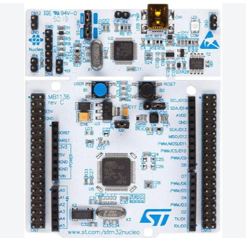

# EXPERIMENT DETAILS

**EXP:** CONTINUOUS LAB EVALUATION – 12

**DATE:** 14/10/2026

**NAME OF EXP:** STM32F401RE – On-board LED Bring-Up Using GPIO

**HARDWARE SETUP / PLATFORM:** STM32 NUCLEO-F401RE Development Board + Debugger + STM32CubeMX + Keil MDK

---

## TASK 1 – On-board LED Bring-Up

### 1. Circuit Diagram

The experiment uses the STM32F401RE Nucleo development board to verify GPIO output configuration by blinking the on-board LED at a fixed time interval.

- **Development Board:** STM32 NUCLEO-F401RE
- **Microcontroller:** STM32F401RE Cortex-M4
- **Communication Interface:** GPIO
- **GPIO Port:** GPIOA
- **GPIO Pin:** PA5
- **Pin Configuration:** Output Push-Pull
- **LED:** On-board LED (LD2)
- **Toggle Interval:** 3000 ms (3 seconds)
- **Programming Environment:** STM32CubeMX and Keil MDK
- **Library:** STM32 HAL Library

### 2. Core Logic / Pseudocode / Code Base

**Working Principle:**

The experiment demonstrates GPIO output configuration and LED control using the STM32F401RE microcontroller.

The STM32 HAL library is initialized, and the system clock is configured using the internal high-speed oscillator (HSI) and PLL. GPIOA clock is enabled, and pin PA5 is configured as a general-purpose output push-pull pin.

The on-board LED is initially set to LOW. Inside the infinite loop, the `HAL_GPIO_TogglePin()` function changes the output state of PA5. The `HAL_Delay(3000)` function introduces a delay of 3000 milliseconds between each toggle.

As a result, the on-board LED continuously turns ON and OFF at fixed intervals.

**Pseudocode:**

1. Initialize the HAL library using `HAL_Init()`.
2. Configure the system clock using `SystemClock_Config()`.
3. Initialize GPIO using `MX_GPIO_Init()`.
4. Enable the GPIOA peripheral clock.
5. Configure PA5 as an output push-pull pin.
6. Set the initial output state of PA5 to LOW.
7. Enter an infinite loop.
8. Toggle the output state of PA5 using `HAL_GPIO_TogglePin()`.
9. Introduce a delay of 3000 milliseconds using `HAL_Delay(3000)`.
10. Repeat the process continuously.

**Code Base:**

The program is written in Embedded C using the STM32 HAL library.

- `HAL_Init()` – Initializes the HAL library and resets the peripherals.
- `SystemClock_Config()` – Configures the system clock using HSI and PLL. The configured system clock frequency is 84 MHz.
- `MX_GPIO_Init()` – Enables the GPIOA clock and configures PA5 as an output push-pull pin.
- `HAL_GPIO_WritePin()` – Sets the initial output state of PA5 to LOW.
- `HAL_GPIO_TogglePin()` – Toggles the output state of the LED pin.
- `HAL_Delay(3000)` – Provides a delay of 3000 milliseconds (3 seconds).
- `main()` – Initializes the microcontroller peripherals and continuously toggles the on-board LED inside the infinite loop.
- `Error_Handler()` – Handles errors that occur during peripheral or clock initialization.

**GPIO Configuration:**

| Parameter | Configuration |
|---|---|
| GPIO Port | GPIOA |
| GPIO Pin | PA5 |
| GPIO Mode | Output Push-Pull |
| Pull-up / Pull-down | No Pull-up, No Pull-down |
| Output Speed | Low |
| Initial Output State | LOW |
| Toggle Delay | 3000 ms |

**Clock Configuration:**

| Parameter | Configuration |
|---|---|
| Clock Source | HSI |
| HSI Frequency | 16 MHz |
| PLLM | 8 |
| PLLN | 84 |
| PLLP | DIV2 |
| System Clock | 84 MHz |
| AHB Prescaler | DIV1 |
| APB1 Prescaler | DIV2 |
| APB2 Prescaler | DIV1 |

### 3. INFERENCE

The experiment successfully demonstrates GPIO output configuration and control using the STM32F401RE Nucleo development board.

The PA5 pin is configured as an output push-pull pin and connected to the on-board LED. The `HAL_GPIO_TogglePin()` function changes the LED state, while `HAL_Delay(3000)` maintains a fixed interval of 3 seconds between toggles.

This experiment verifies the basic operation of GPIO peripherals, system clock configuration, and STM32 HAL library functions. It also provides a foundation for further experiments involving digital input, push-button control, and other GPIO-based applications.
