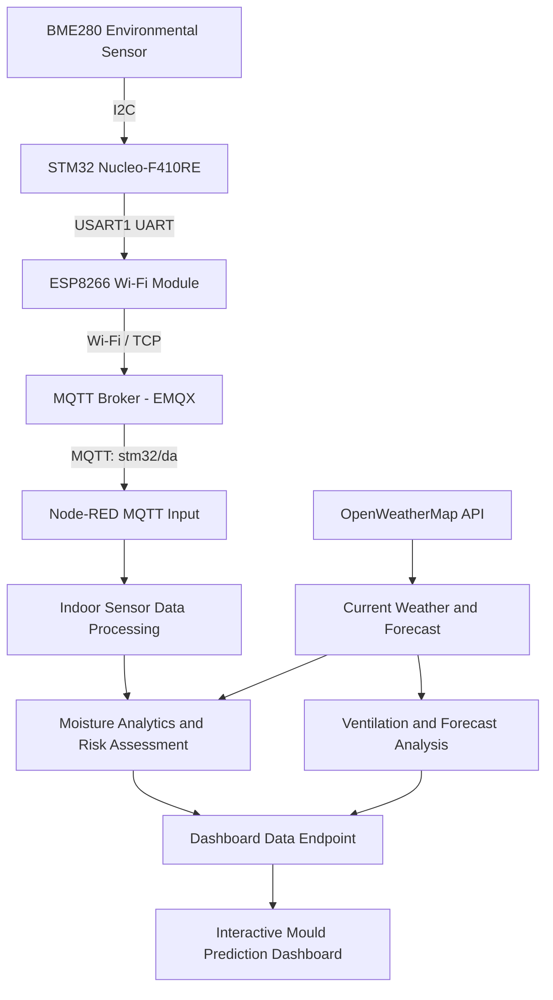
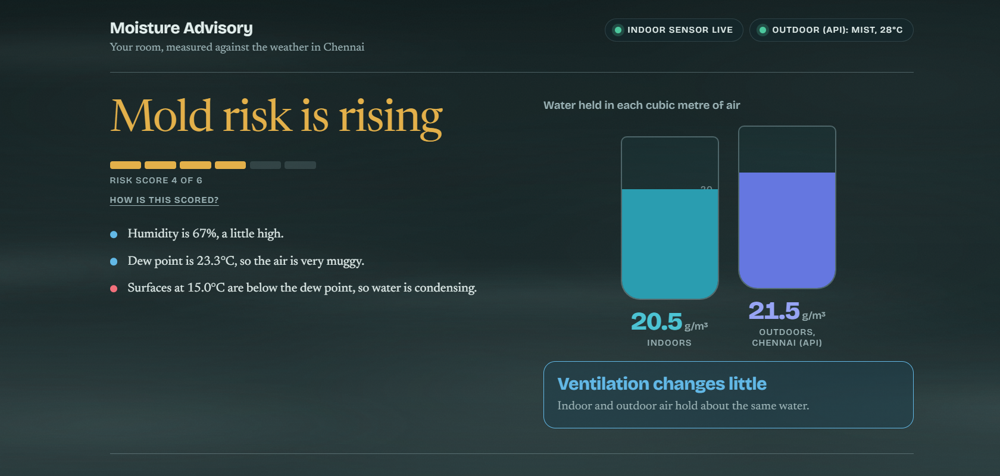
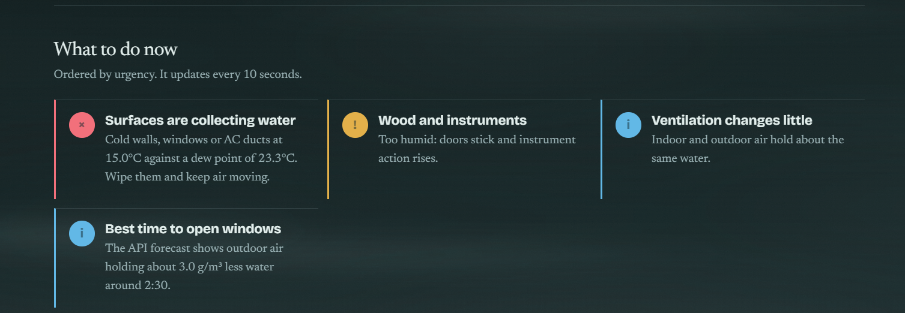
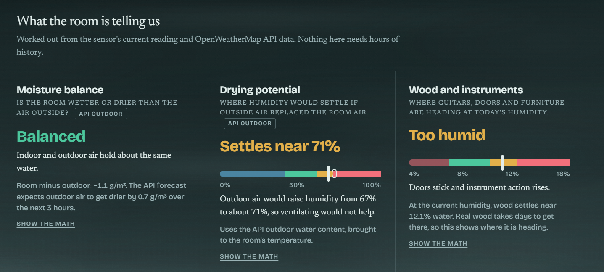
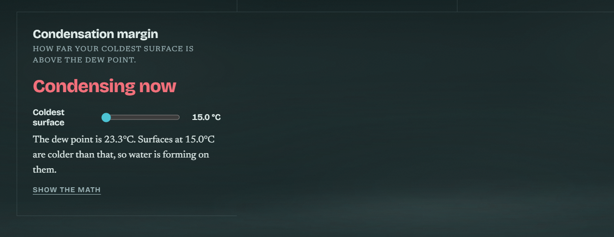
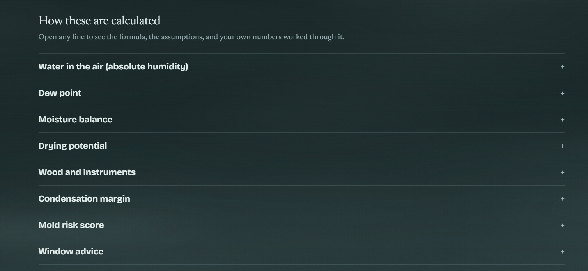
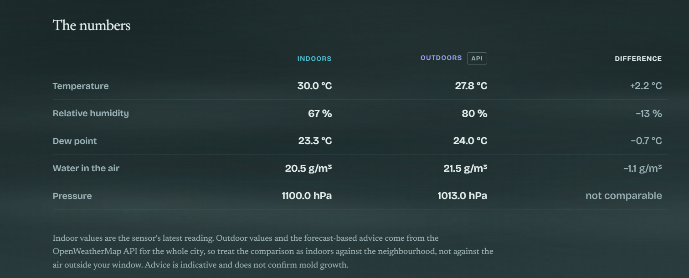
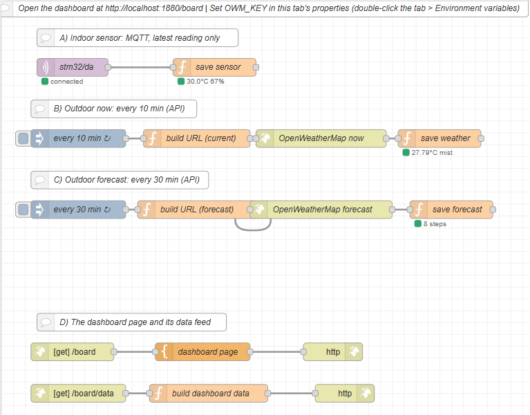

EXPERIMENT DETAILS
EXP: CONTINUOUS LAB EVALUATION – 15

DATE: 27/10/2026

NAME OF EXP: BME280 Sensor Interfacing Using I²C and MQTT for Node-RED Analytics

HARDWARE SETUP / PLATFORM: CubeMX + Keil MDK + STM32 Nucleo Development Board + Debugger + BME280 Sensor + ESP8266 Wi-Fi Module# Mould Prediction Dashboard – IoT-Based Indoor Moisture Monitoring and Advisory System

## 1. Project Overview

The **Mould Prediction Dashboard** is an IoT-based environmental monitoring and indoor moisture advisory system designed to assess indoor conditions that may encourage mould growth.

The system collects real-time temperature, relative humidity and atmospheric pressure readings from a BME280 environmental sensor connected to an STM32 Nucleo-F410RE development board. An ESP8266 Wi-Fi module transmits the sensor readings to Node-RED using the MQTT communication protocol.

In addition to indoor sensor measurements, the system retrieves current outdoor weather conditions and short-term weather forecasts through the OpenWeatherMap API.

Node-RED acts as the central processing and analytics platform. It combines indoor sensor measurements with outdoor weather information to calculate absolute humidity, dew point, condensation margin, moisture balance and a rule-based mould risk score.

The processed information is presented through a custom-designed, interactive web dashboard that provides environmental diagnostics, ventilation recommendations, forecast analysis and moisture-related warnings.

The objective is not simply to monitor environmental parameters, but to interpret them and provide actionable recommendations to help maintain healthier indoor conditions and reduce the possibility of mould formation.

---

## 2. Project Objectives

- Interface the BME280 environmental sensor with the STM32 Nucleo-F410RE using I²C communication.
- Establish wireless communication using an ESP8266 Wi-Fi module.
- Transmit environmental measurements to an MQTT broker.
- Integrate Node-RED for receiving, processing and analysing sensor data.
- Retrieve real-time outdoor weather information through the OpenWeatherMap API.
- Compare indoor and outdoor temperature and humidity conditions.
- Calculate absolute humidity and dew point to understand the actual moisture content of air.
- Estimate condensation conditions using the difference between surface temperature and dew point.
- Develop a rule-based mould risk assessment mechanism.
- Analyse forecast conditions to identify suitable ventilation periods.
- Generate recommendations for ventilation, dehumidification and condensation prevention.
- Display the results through an interactive, responsive web dashboard.

---

## 3. System Architecture

The project consists of three major layers:

1. **Hardware and Data Acquisition Layer:** BME280, STM32 Nucleo-F410RE and ESP8266.
2. **Communication and Processing Layer:** Wi-Fi, MQTT, OpenWeatherMap API and Node-RED.
3. **Analytics and Presentation Layer:** Moisture calculations, mould risk assessment, forecast analysis and the web dashboard.

### 3.1 Overall Architecture



### 3.2 Hardware Components

| Component                            | Purpose                                                          |
| ------------------------------------ | ---------------------------------------------------------------- |
| STM32 Nucleo-F410RE                  | Main microcontroller for sensor acquisition and communication    |
| BME280                               | Measures temperature, relative humidity and atmospheric pressure |
| ESP8266 / ESP8266-based Wi-Fi module | Provides wireless network connectivity                           |
| Debugger                             | Programming and debugging the STM32                              |
| Computer / Laptop                    | Runs Node-RED and hosts the dashboard                            |
| Wi-Fi network                        | Provides internet connectivity for MQTT and weather API access   |

### 3.3 Software and Technologies

| Technology         | Application                                        |
| ------------------ | -------------------------------------------------- |
| STM32CubeMX        | Peripheral configuration                           |
| Keil MDK           | STM32 firmware development                         |
| STM32 HAL          | Hardware abstraction and peripheral communication  |
| BME280 Driver      | Sensor initialization and measurement acquisition  |
| ESP8266 Library    | Wi-Fi and TCP communication                        |
| MQTT               | Wireless transmission of sensor measurements       |
| EMQX Public Broker | MQTT message broker                                |
| Node-RED           | Data acquisition, processing and analytics         |
| OpenWeatherMap API | Current weather and weather forecast               |
| JavaScript         | Node-RED function logic and dashboard calculations |
| HTML and CSS       | Dashboard structure and styling                    |
| SVG                | Interactive data visualizations                    |

---
### 3.4 Dashboard pictures and node red flow






NODE RED FLOW:

## 4. Hardware Interfacing and Sensor Acquisition

### 4.1 BME280 Sensor Interfacing

The BME280 sensor is connected to the STM32 Nucleo-F410RE through the I²C1 communication interface.

The sensor provides three environmental parameters:

- Temperature in degrees Celsius (°C).
- Relative humidity in percentage (%RH).
- Atmospheric pressure in hectopascals (hPa).

The STM32 communicates with the BME280 using the STM32 HAL I²C functions.

The firmware uses:

- `HAL_I2C_Mem_Read()` for reading sensor registers.
- `HAL_I2C_Mem_Write()` for writing sensor registers.
- `bme280_init()` for sensor initialization.
- `bme280_set_sensor_settings()` for configuring measurement settings.
- `bme280_set_sensor_mode()` for selecting normal operating mode.
- `bme280_get_sensor_data()` for retrieving compensated sensor measurements.

The configured sensor parameters include:

- Temperature oversampling: 1X.
- Humidity oversampling: 1X.
- Pressure oversampling: 1X.
- Filter coefficient: Disabled.
- Standby time: 1000 ms.
- Operating mode: Normal mode.

The firmware uses the primary BME280 I²C address (0x76). If the sensor hardware uses the secondary address, the firmware must be configured accordingly.

### 4.2 STM32 Firmware Processing

The STM32 firmware performs the following operations:

1. Initializes the STM32 HAL library.
2. Configures the system clock.
3. Initializes GPIO, I²C1 and USART1.
4. Initializes the BME280 sensor.
5. Configures sensor oversampling and standby settings.
6. Initializes the ESP8266 in station mode.
7. Connects to the configured Wi-Fi network.
8. Establishes a TCP connection with the MQTT broker.
9. Initializes MQTT communication.
10. Reads temperature, humidity and pressure.
11. Converts the readings into JSON format.
12. Publishes the JSON data through MQTT.

The firmware uses `HAL_GetTick()` to maintain a publishing interval of 1000 milliseconds.

### 4.3 JSON Data Formatting

The firmware converts the sensor readings into a JSON message.

Example:

```json
{
  "temperature": 27.45,
  "pressure": 1008.23,
  "humidity": 55.12
}
```

The pressure is converted from pascals (Pa) into hectopascals (hPa) before transmission.

The JSON formatting function is implemented using `buildJson()`.

---

## 5. MQTT Communication

The ESP8266 establishes a connection to the MQTT broker using the TCP protocol.

**MQTT configuration:**

| Parameter           | Configuration  |
| ------------------- | -------------- |
| Broker              | broker.emqx.io |
| Port                | 1883           |
| Client ID           | STM32_da       |
| Topic               | stm32/da       |
| QoS                 | 0              |
| Publishing interval | 1000 ms        |

The STM32 publishes the sensor measurements to the topic:

`stm32/da`

Node-RED subscribes to this topic using an MQTT input node.

The received JSON message is passed to the `save sensor` function node.

### 5.1 Indoor Sensor Data Processing

The `save sensor` function performs the following operations:

1. Reads the incoming MQTT payload.
2. Parses the JSON message if it is received as a string.
3. Extracts temperature, humidity and pressure.
4. Validates the temperature and humidity values.
5. Rejects invalid humidity readings outside the 0–100% range.
6. Converts pressure from Pa to hPa when required.
7. Stores the latest sensor reading in Node-RED flow context.

The stored structure is:

```javascript
{
    t: temperature,
    h: humidity,
    p: pressure,
    ts: timestamp
}
```

The project maintains only the latest indoor sensor reading rather than storing a continuous historical database.

An indoor reading is considered live if it is less than three minutes old.

---

## 6. Outdoor Weather Data Integration

The project integrates the OpenWeatherMap API to obtain outdoor environmental information.

This allows the system to compare indoor measurements with actual outdoor weather conditions rather than analysing indoor humidity independently.

The Node-RED flow contains two independent weather acquisition processes.

### 6.1 Current Weather Acquisition

The current weather API is triggered every 10 minutes.

The `build URL (current)` function constructs the API request using:

- `OWM_KEY`: OpenWeatherMap API key.
- `OWM_CITY`: Configured city, defaulting to Chennai.

The API endpoint is:

```text
https://api.openweathermap.org/data/2.5/weather
```

The request uses metric units.

The HTTP Request node retrieves the response, and the `save weather` function extracts:

- Outdoor temperature.
- Outdoor relative humidity.
- Atmospheric pressure.
- Feels-like temperature.
- Cloud coverage.
- Wind speed.
- Weather description.
- Weather category.
- Rain conditions.
- Day/night information.
- City name.

The information is stored in Node-RED flow context.

The weather information is considered live for 30 minutes.

### 6.2 Weather Forecast Acquisition

The forecast API is triggered every 30 minutes.

The project uses the OpenWeatherMap five-day forecast endpoint:

```text
https://api.openweathermap.org/data/2.5/forecast
```

The request uses:

```text
units=metric&cnt=8
```

The eight forecast entries represent eight three-hour forecast intervals, providing approximately 24 hours of forecast information.

The `save forecast` function processes each forecast entry and extracts:

- Forecast temperature.
- Forecast humidity.
- Atmospheric pressure.
- Forecast timestamp.
- Probability of precipitation.
- Weather description.
- Rain or thunderstorm conditions.
- Calculated absolute humidity.

The processed forecast is stored in Node-RED flow context.

---

## 7. Node-RED Flow Architecture and Function Node Explanation

The Node-RED flow is organized into four major sections.

### Section A – Indoor Sensor Acquisition

**Nodes:**

1. MQTT Input – `stm32/da`
2. Function – `save sensor`

The MQTT input node continuously receives measurements from the STM32.

The function node validates the incoming payload and stores the latest indoor sensor measurements.

This section provides the real-time indoor environmental data used by the dashboard.

### Section B – Current Outdoor Weather

**Nodes:**

1. Inject – `every 10 min`
2. Function – `build URL (current)`
3. HTTP Request – `OpenWeatherMap now`
4. Function – `save weather`

This section retrieves current outdoor weather information every 10 minutes.

The processed information is stored in flow context for comparison with the indoor sensor measurements.

### Section C – Outdoor Weather Forecast

**Nodes:**

1. Inject – `every 30 min`
2. Function – `build URL (forecast)`
3. HTTP Request – `OpenWeatherMap forecast`
4. Function – `save forecast`

This section retrieves eight forecast intervals and calculates absolute humidity for each interval.

The forecast data is used to identify favourable ventilation periods.

### Section D – Dashboard and Data Processing

**Nodes:**

1. HTTP Input – `/board`
2. Template – `dashboard page`
3. HTTP Response
4. HTTP Input – `/board/data`
5. Function – `build dashboard data`
6. HTTP Response

The `/board` endpoint serves the custom HTML dashboard.

The `/board/data` endpoint generates the latest JSON response containing indoor readings, outdoor readings, derived environmental parameters, mould risk assessment, recommendations and forecast information.

The dashboard requests updated information every 10 seconds.

---

## 8. Moisture Analytics and Mathematical Calculations

The central feature of the project is the comparison of indoor and outdoor moisture conditions.

Relative humidity alone does not accurately describe how much water vapour is present in the air because warm air can hold more moisture than cold air.

Therefore, the system calculates absolute humidity and dew point before generating ventilation and condensation recommendations.

### 8.1 Absolute Humidity

Absolute humidity represents the mass of water vapour present in a unit volume of air.

It is calculated using temperature and relative humidity.

The formula implemented in Node-RED is:

[
e=\frac{RH}{100}\times6.112
\times e^{\frac{17.67T}{T+243.5}}
]

[
AH=\frac{216.7e}{273.15+T}
]

Where:

- (T) = Temperature in °C.
- (RH) = Relative humidity in %.
- (e) = Actual water vapour pressure in hPa.
- (AH) = Absolute humidity in g/m³.

The system calculates:

- Indoor absolute humidity using BME280 measurements.
- Outdoor absolute humidity using OpenWeatherMap measurements.
- Forecast absolute humidity for each forecast interval.

This makes it possible to compare the actual moisture content of indoor and outdoor air.

### 8.2 Dew Point Calculation

Dew point is the temperature at which air becomes saturated and water vapour begins to condense.

The system uses the Magnus approximation:

[
\gamma=\ln\left(\frac{RH}{100}\right)
+\frac{17.62T}{243.12+T}
]

[
T_d=\frac{243.12\gamma}{17.62-\gamma}
]

Where:

- (T) = Air temperature.
- (RH) = Relative humidity.
- (T_d) = Dew point temperature.

The calculation is performed independently for indoor and outdoor conditions.

The indoor dew point is especially important because it indicates the temperature at which indoor moisture may condense on cold surfaces.

### 8.3 Condensation Margin

The dashboard allows the user to specify an estimated surface temperature.

The default value is 23°C, and the adjustable range is 10–35°C.

The condensation margin is calculated as:

[
M=T_s-T_d
]

Where:

- (T_s) = Assumed surface temperature.
- (T_d) = Indoor dew point.

Interpretation:

| Condensation Margin | Interpretation                                                 |
| ------------------- | -------------------------------------------------------------- |
| Greater than 2°C    | Lower immediate condensation concern                           |
| Between 0°C and 2°C | Surface is close to condensation                               |
| 0°C or below        | Surface is at or below the dew point; condensation is possible |

This calculation helps identify conditions under which water may accumulate on cold walls, windows and air-conditioning ducts.

### 8.4 Indoor and Outdoor Moisture Balance

The system compares indoor and outdoor absolute humidity.

[
\Delta AH=AH\_{indoor}-AH\_{outdoor}
]

The calculated difference determines whether outdoor air can help reduce indoor moisture.

| Absolute Humidity Difference | Interpretation                                                               |
| ---------------------------- | ---------------------------------------------------------------------------- |
| +2 g/m³ or greater           | Outdoor air is sufficiently drier; ventilation can help                      |
| -2 g/m³ or lower             | Outdoor air contains more moisture; ventilation may increase indoor moisture |
| Between -2 and +2 g/m³       | Indoor and outdoor moisture levels are relatively similar                    |

The system also checks whether it is raining before recommending that windows be opened.

### 8.5 Equivalent Indoor Humidity After Ventilation

The system estimates what indoor relative humidity would become if the room air were replaced by outdoor air while maintaining the current indoor temperature.

The calculation uses the outdoor absolute humidity and the indoor temperature.

This helps demonstrate why relative humidity can change even when the actual water vapour content is reduced.

### 8.6 Wood Equilibrium Moisture Content

The project also includes an additional environmental diagnostic based on the Hailwood–Horrobin equilibrium moisture content (EMC) model.

This estimates the equilibrium moisture content of wood under the measured indoor temperature and relative humidity.

The calculated result is used to provide advisory information concerning:

- Excessively humid conditions.
- Potential swelling of wooden materials.
- Changes in doors and instrument action.
- Conditions associated with drying and cracking.

This is an additional material-moisture advisory, not a direct measurement of the moisture content of wood.

---

## 9. Rule-Based Mould Risk Assessment

The Node-RED flow implements a rule-based mould risk scoring mechanism using the latest indoor sensor reading.

It is important to note that this is a threshold-based environmental risk assessment, not a machine-learning model or a direct biological mould detector.

The maximum score is six.

### 9.1 Risk Scoring Parameters

**Parameter 1 – Relative Humidity**

| Indoor Relative Humidity | Score |
| ------------------------ | ----: |
| Below 60%                |     0 |
| 60–69%                   |     1 |
| 70–79%                   |     2 |
| 80% or above             |     3 |

**Parameter 2 – Dew Point**

| Indoor Dew Point | Score |
| ---------------- | ----: |
| Below 22°C       |     0 |
| 22°C or above    |     1 |

**Parameter 3 – Condensation Margin**

| Condensation Margin          | Score |
| ---------------------------- | ----: |
| Greater than or equal to 2°C |     0 |
| Between 0°C and 2°C          |     1 |
| 0°C or below                 |     2 |

The final risk score is:

[
R=S\_{RH}+S\_{DP}+S_M
]

Where:

- (S\_{RH}) = Relative humidity score.
- (S\_{DP}) = Dew point score.
- (S_M) = Condensation margin score.

### 9.2 Risk Classification

The Node-RED function uses the following thresholds:

| Risk Score | Risk Level | Dashboard Status            |
| ---------- | ---------- | --------------------------- |
| 0–1        | Level 0    | Mold risk is low            |
| 2          | Level 1    | Worth watching              |
| 3–4        | Level 2    | Mold risk is rising         |
| 5–6        | Level 3    | Mold conditions are present |

The implementation also includes hysteresis.

Hysteresis reduces unnecessary changes between risk levels when the calculated score fluctuates around a threshold.

The system uses the previous risk level when determining whether to lower the current risk classification.

The dashboard displays the risk headline, corresponding status colour and contributing environmental factors.

---

## 10. Ventilation Recommendation System

The system provides recommendations based on the indoor and outdoor absolute humidity difference.

The ventilation logic considers three major conditions:

**Condition 1 – Outdoor Air Is Drier**

If outdoor absolute humidity is at least 2 g/m³ lower than indoor absolute humidity, the system recommends opening windows, provided it is not raining.

**Condition 2 – Outdoor Air Is More Humid**

If outdoor absolute humidity is at least 2 g/m³ higher than indoor absolute humidity, the system recommends keeping windows closed.

**Condition 3 – Similar Moisture Conditions**

If the difference is between -2 and +2 g/m³, the system indicates that ventilation is unlikely to make a significant difference.

**Rain Detection**

If the current weather API reports rain, drizzle or thunderstorms, the system recommends keeping windows closed.

When indoor humidity is at least 70% and outdoor conditions are unsuitable for ventilation, the system recommends mechanical drying through:

- Air conditioning in dry mode.
- A dehumidifier.

These recommendations are generated dynamically according to the latest available environmental information.

---

## 11. Forecast-Based Ventilation Planning

The system uses the eight forecast intervals obtained from OpenWeatherMap to identify favourable ventilation periods.

For each forecast interval, Node-RED calculates absolute humidity.

It then compares forecast absolute humidity with the current indoor absolute humidity.

[
G=AH\_{indoor}-AH\_{forecast}
]

Where:

- (G) = Potential moisture reduction.
- (AH\_{indoor}) = Current indoor absolute humidity.
- (AH\_{forecast}) = Forecast outdoor absolute humidity.

The forecast classification is:

- **Open:** Outdoor air is at least 2 g/m³ drier than the indoor air and the forecast does not indicate rain.
- **Closed:** Outdoor air is at least 2 g/m³ more humid.
- **Neutral:** The difference is small.
- **Rain:** Forecast precipitation or rainy weather is detected.

The system identifies the forecast interval with the highest favourable moisture reduction and highlights it as the best ventilation opportunity.

This provides a forward-looking recommendation instead of relying only on current outdoor conditions.

---

## 12. Additional Environmental Diagnostics

Apart from mould risk and ventilation advice, the dashboard includes several additional diagnostics.

### 12.1 Moisture Balance

Compares indoor and outdoor absolute humidity and determines whether the room is wetter, drier or approximately balanced relative to the outdoor environment.

### 12.2 Drying Potential

Estimates the relative humidity that would result if outdoor air replaced indoor air while the indoor temperature remained constant.

### 12.3 Wood and Instruments

Uses the estimated equilibrium moisture content of wood to identify conditions that may be unsuitable for wooden furniture and musical instruments.

### 12.4 Condensation Margin

Compares the assumed surface temperature against the indoor dew point.

### 12.5 Outdoor Pressure Trend

Compares the first two forecast pressure readings to estimate the pressure change over approximately three hours.

The dashboard generates an advisory when pressure falls or rises by at least 2 hPa.

A falling pressure trend is presented as a possible indication of changing weather conditions, while a rising trend suggests potentially improving conditions.

---

## 13. Dashboard Design and Features

The Node-RED dashboard is a custom HTML, CSS and JavaScript application served through an HTTP endpoint.

It can be accessed using:

`http://localhost:1880/board`

The dashboard is designed to present environmental information in a visually understandable form.

### 13.1 Live System Status

The dashboard displays the connection status of:

- Indoor BME280 sensor.
- Outdoor weather API.

It also monitors the age of the latest readings.

The system displays an offline warning when the indoor sensor reading is older than three minutes or when outdoor weather information is older than 30 minutes.

### 13.2 Mould Risk Overview

The main dashboard section displays:

- Current mould risk classification.
- Risk level.
- Risk score.
- Environmental factors contributing to the risk.

Different colours are used to distinguish low, moderate and high advisory conditions.

### 13.3 Indoor and Outdoor Moisture Comparison

The dashboard provides visual comparisons of the water vapour content of indoor and outdoor air.

This makes it easier to understand which environment contains more moisture.

### 13.4 Ventilation Recommendations

The dashboard provides recommendations based on the current outdoor weather and indoor moisture conditions.

It indicates whether windows should be opened, kept closed or whether ventilation is unlikely to provide significant benefit.

### 13.5 Environmental Diagnostics

The dashboard includes separate diagnostic sections for:

- Moisture balance.
- Drying potential.
- Wood and instruments.
- Condensation margin.

### 13.6 Forecast Visualization

The dashboard displays the upcoming forecast intervals and identifies suitable ventilation opportunities.

The best available forecast ventilation interval is highlighted.

### 13.7 Adjustable Surface Temperature

The user can modify the estimated surface temperature using an interactive slider.

The selected temperature is used to recalculate the condensation margin and associated mould risk assessment.

The surface temperature selection is retained in browser local storage.

### 13.8 Interactive Charts and Data Presentation

The dashboard includes custom SVG-based visualizations, comparison indicators and numerical tables to make environmental information easier to interpret.

### 13.9 Dynamic Weather-Based Appearance

The interface includes weather-dependent background effects and themes.

Different appearances are used for clear weather, clouds, rain, mist, snow, storms and night conditions.

The dashboard also supports dark-mode styling and reduced-motion preferences.

---

## 14. Node-RED Data Endpoints

The project exposes two HTTP endpoints.

| Endpoint      | Method | Purpose                                                                 |
| ------------- | ------ | ----------------------------------------------------------------------- |
| `/board`      | GET    | Serves the dashboard HTML page                                          |
| `/board/data` | GET    | Returns processed environmental and advisory information in JSON format |

The `/board/data` endpoint accepts an optional `surface` query parameter.

Example:

```text
http://localhost:1880/board/data?surface=23
```

The parameter represents the assumed surface temperature in degrees Celsius.

The value is restricted to a range of 10–35°C, with 23°C as the default.

The dashboard polls the data endpoint every 10 seconds and updates the displayed information.

The data endpoint returns:

- Current timestamp.
- Surface temperature.
- Indoor and outdoor sensor status.
- Reading age.
- Indoor sensor measurements.
- Outdoor weather measurements.
- Derived moisture parameters.
- Mould risk score and classification.
- Ventilation verdict.
- Recommendations.
- Environmental diagnostics.
- Forecast information.
- Outdoor pressure trend.

---

## 16. Expected System Workflow

The complete project operates as follows:

1. The BME280 continuously measures indoor temperature, humidity and pressure.
2. The STM32 reads the measurements through I²C1.
3. The firmware formats the readings into JSON.
4. The ESP8266 transmits the readings through MQTT.
5. Node-RED receives the messages through the MQTT input node.
6. The latest indoor measurements are stored in flow context.
7. Node-RED periodically retrieves current outdoor weather data.
8. Node-RED separately retrieves weather forecast information.
9. The dashboard data-processing function combines the latest available measurements.
10. Absolute humidity, dew point and condensation margin are calculated.
11. A rule-based mould risk score is generated.
12. Indoor and outdoor moisture conditions are compared.
13. Ventilation recommendations are generated.
14. Forecast data is analysed to identify favourable ventilation periods.
15. Additional diagnostics and recommendations are generated.
16. The processed information is returned through the dashboard data endpoint.
17. The browser refreshes the information every 10 seconds.

---

## 17. Error Handling and Reliability

The project includes several basic mechanisms for handling invalid or unavailable data.

### Indoor Sensor Validation

- Invalid JSON messages are rejected.
- Missing or invalid temperature and humidity values are rejected.
- Humidity values outside the valid range are rejected.
- Pressure is converted to hPa when the received value is in Pa.
- Readings older than three minutes are considered offline.

### Weather API Validation

- API responses are checked for successful status codes.
- Missing weather data is rejected.
- API errors are displayed through Node-RED node status and warnings.
- Missing API keys generate a warning.
- Weather information older than 30 minutes is treated as stale.

### Dashboard Handling

- The dashboard displays an offline notification when its data request fails.
- Missing indoor or outdoor data is handled separately.
- The dashboard can continue displaying available information even if one data source is unavailable.

### Communication Considerations

The MQTT configuration uses QoS 0, which does not guarantee delivery of every message.

The supplied firmware also performs its Wi-Fi and MQTT initialization during startup. Automatic reconnection and recovery after a connection failure are not implemented explicitly in the shown main firmware.

---

## 19. Conclusion

The Mould Prediction Dashboard integrates embedded systems, IoT communication, cloud-based weather information and environmental analytics into a unified indoor moisture monitoring system.

The BME280 sensor provides real-time indoor environmental measurements through the STM32 Nucleo-F410RE. The ESP8266 enables wireless communication using MQTT, allowing Node-RED to receive and process the measurements.

The integration of OpenWeatherMap provides additional outdoor environmental information and weather forecasts.

By comparing indoor and outdoor absolute humidity, calculating dew point and condensation margin, and applying a rule-based mould risk assessment, the system provides meaningful information about indoor moisture conditions.

The dashboard further extends the functionality by providing ventilation recommendations, forecast-based drying opportunities, condensation diagnostics and material moisture advisories.

Thus, the project demonstrates how embedded hardware, wireless communication, external weather APIs and Node-RED analytics can be combined to create an intelligent environmental monitoring and moisture advisory platform.

**The final objective is to move beyond conventional temperature and humidity monitoring towards an informative, predictive-style decision-support system that helps users understand and manage indoor moisture conditions.**
