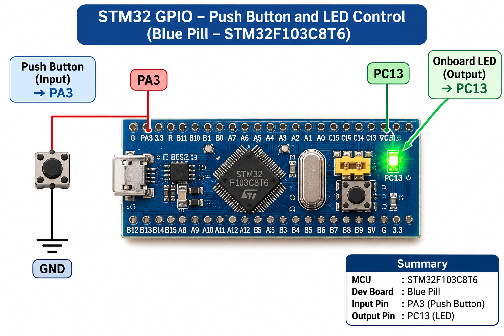

# EXPERIMENT DETAILS

**EXP:** CONTINUOUS ASSESSMENT 8

**DATE:** 18/09/2026

**NAME OF EXP:** STM32 GPIO Bring-Up and Switch-Controlled LED

**HARDWARE SETUP / PLATFORM:** STM32CubeMX + Keil MDK + STM32 Development Board (Blue Pill – STM32F103C8T6)

---

## TASK 8C – Short Press vs Long Press

### 1. Circuit Diagram

The experiment uses a push-button connected to the STM32 GPIO input pin and the onboard LED connected to the GPIO output pin.

- **Development Board:** STM32 Blue Pill
- **Microcontroller IC:** STM32F103C8T6
- **GPIO Input Pin:** PA3 – Push-button
- **GPIO Output Pin:** PC13 – Onboard LED
- **Button Configuration:** Input with internal pull-up resistor
- **LED Configuration:** Output push-pull

**Hardware Connections:**

- Connect one terminal of the push-button to PA3.
- Connect the other terminal of the push-button to GND.
- The onboard LED is controlled through PC13.

### 2. Core Logic / Pseudocode / Code Base

**Working Principle:**

This experiment demonstrates the detection of short and long button presses using the STM32 GPIO input and the HAL time-base function.

The push-button is connected to PA3, which is configured as an input with an internal pull-up resistor. When the button is pressed, the input reads LOW.

The program records the button press time using `HAL_GetTick()` and continues executing without using a blocking delay to measure the press duration.

When the button is released, the release time is recorded and the press duration is calculated.

- **Short Press:** Less than 1 second. The LED toggles its state. If the LED is in blinking mode, a short press stops blinking and turns the LED OFF.
- **Long Press:** 1 second or more. The LED enters continuous blinking mode.
- **Blinking Mode:** The LED toggles every 300 milliseconds. The blinking continues until a short press stops it.

A 50 ms time-based debounce check is used to reduce the effect of mechanical switch bouncing.

**Pseudocode:**

1. Initialize the HAL library.
2. Configure the system clock.
3. Initialize GPIO peripherals.
4. Configure PA3 as an input with an internal pull-up resistor.
5. Configure PC13 as an output push-pull pin.
6. Continuously monitor the push-button state.
7. When a new button press is detected:
   - Record the press start time using `HAL_GetTick()`.
8. When the button is released:
   - Record the release time.
   - Calculate the press duration.
   - If the duration is less than 1 second:
     - If blinking mode is active, stop blinking and turn the LED OFF.
     - Otherwise, toggle the LED state.
   - If the duration is 1 second or more:
     - Enable blinking mode.
     - Record the starting time for LED blinking.
9. If blinking mode is active:
   - Toggle the LED every 300 milliseconds.
10. Repeat continuously.

**Code Base:**

The experiment uses the following STM32 HAL functions:

| Purpose | HAL Function |
|---|---|
| Read push-button state | `HAL_GPIO_ReadPin()` |
| Toggle LED state | `HAL_GPIO_TogglePin()` |
| Control LED ON/OFF | `HAL_GPIO_WritePin()` |
| Measure press duration | `HAL_GetTick()` |
| Initialize GPIO | `HAL_GPIO_Init()` |
| Initialize HAL library | `HAL_Init()` |

### 3. INFERENCE

The experiment demonstrates short-press and long-press detection using the STM32 Blue Pill development board.

A short button press toggles the onboard LED, while a long button press activates continuous LED blinking. A subsequent short press stops the blinking and turns the LED OFF.

The implementation uses `HAL_GetTick()` to measure button press duration without blocking the application using delays. The 50 ms debounce check helps reduce unwanted multiple detections caused by switch bouncing.

Thus, the experiment demonstrates event-based GPIO control, button press duration measurement, software debouncing and non-blocking LED control using STM32 HAL functions.
