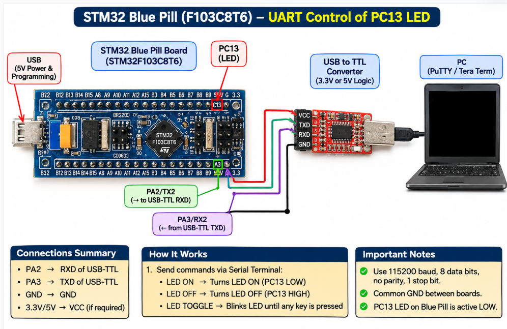

# EXPERIMENT DETAILS

**EXP:** CONTINUOUS ASSESSMENT 9

**DATE:** 28/09/2026

**NAME OF EXP:** STM32 UART-Based LED Control Using String Commands

**HARDWARE SETUP / PLATFORM:** STM32CubeMX + Keil MDK + STM32 Development Board Blue Pill STM32F103C8T6

---

## TASK 9B – String-Based Application Logic

### 1. Circuit Diagram

The experiment uses UART communication between the STM32 Blue Pill development board and a PC terminal to control the onboard LED using string commands.

- **Development Board:** STM32 Blue Pill
- **Microcontroller IC:** STM32F103C8T6
- **UART Peripheral:** USART2
- **UART TX Pin:** PA2
- **UART RX Pin:** PA3
- **GPIO Pin:** PC13
- **Peripheral:** Onboard LED
- **Communication Interface:** USB-to-TTL Serial Converter
- **Baud Rate:** 115200 bps

The TX and RX pins of the STM32 are connected to the corresponding RX and TX pins of the USB-to-TTL converter, with a common GND connection. The onboard LED is controlled through GPIO pin PC13.

### 2. Core Logic / Pseudocode / Code Base

**Working Principle:**

The experiment demonstrates string-based UART communication to control the onboard LED of the STM32 Blue Pill using the STM32 HAL library.

USART2 is configured with a baud rate of 115200, 8 data bits, no parity, and 1 stop bit.

The STM32 receives characters from the PC terminal using `HAL_UART_Receive()` and echoes each received character back using `HAL_UART_Transmit()`. The received characters are stored in a character buffer until the Enter key is pressed.

The received string is compared with predefined commands using `strcmp()`.

- **LED ON:** Turns ON the onboard LED by setting PC13 to RESET.
- **LED OFF:** Turns OFF the onboard LED by setting PC13 to SET.
- **LED TOGGLE:** Continuously toggles the onboard LED at 300 ms intervals using `HAL_GPIO_TogglePin()` and `HAL_Delay()`.
- **Invalid Command:** Displays an INVALID message if the entered command does not match any predefined command.

After executing a command, the buffer index is reset to receive the next command.

**Pseudocode:**

1. Initialize the HAL library.
2. Configure the system clock.
3. Initialize GPIO and USART2 peripherals.
4. Configure UART with 115200 baud rate and 8N1 configuration.
5. Declare a character variable and a string buffer.
6. Receive characters from the PC terminal using `HAL_UART_Receive()`.
7. Echo each received character back to the PC using `HAL_UART_Transmit()`.
8. Store the received characters in the string buffer.
9. When Enter is pressed, terminate the string with a null character.
10. Compare the received string with predefined commands:
    - If the command is `LED ON`, turn ON the LED.
    - If the command is `LED OFF`, turn OFF the LED.
    - If the command is `LED TOGGLE`, continuously toggle the LED with a 300 ms delay.
    - Otherwise, display an INVALID message.
11. Reset the buffer index for the next command.
12. Repeat the process continuously.

**Code Base:**

The experiment uses the following STM32 HAL functions and standard C library functions:

- `HAL_UART_Init()` – Initializes the USART2 peripheral.
- `HAL_UART_Receive()` – Receives characters from the PC terminal.
- `HAL_UART_Transmit()` – Transmits received characters and response messages.
- `HAL_GPIO_WritePin()` – Turns the onboard LED ON or OFF.
- `HAL_GPIO_TogglePin()` – Toggles the onboard LED state.
- `HAL_Delay()` – Introduces a 300 ms delay during LED toggling.
- `strcmp()` – Compares the received command with predefined strings.
- `strlen()` – Calculates the length of response messages.

### 3. Inference

The STM32 Blue Pill successfully receives string commands from the PC terminal and controls the onboard LED accordingly. The commands `LED ON`, `LED OFF`, and `LED TOGGLE` perform their respective operations, while invalid commands generate an error message.

Thus, the experiment demonstrates UART-based string reception, command processing, GPIO control, and interactive LED operation using STM32 HAL libraries.
